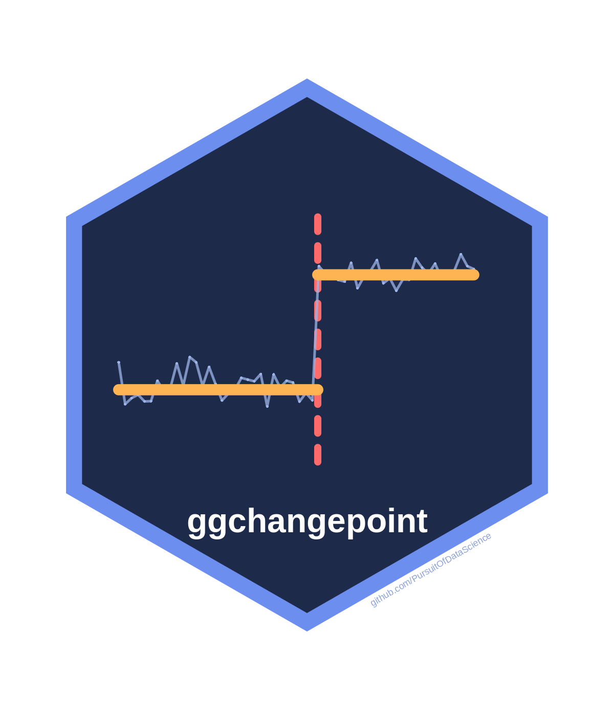
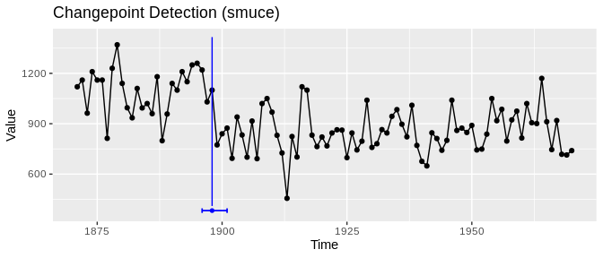

<!-- README.md is generated from README.Rmd. Please edit that file -->

# ggchangepoint 

<!-- badges: start -->

[](https://github.com/PursuitOfDataScience/ggchangepoint/actions/workflows/R-CMD-check.yaml)
[](https://CRAN.R-project.org/package=ggchangepoint)
<!-- badges: end -->

**Find where a time series changed with any of 51 methods, and get the
same tidy, plottable answer from every one.**

## 🔍 One series, one call, one picture

``` r
library(ggchangepoint)
fit <- cpt_detect(Nile, method = "smuce")
fit$changepoints
#> # A tibble: 1 × 5
#>      cp cp_index cp_value ci_lower ci_upper
#>   <int>    <dbl>    <dbl>    <int>    <int>
#> 1    28     1898     1100       26       31
autoplot(fit, show_ci = TRUE)
```



Five detectors built on different ideas agree:

``` r
ggcpt_compare_table(Nile, methods = c("smuce", "not", "wbs", "mosum",
                                      "strucchange"))
#> # A tibble: 5 × 3
#>   method         cp cp_value
#>   <chr>       <int>    <dbl>
#> 1 smuce          28     1100
#> 2 not            28     1100
#> 3 wbs            28     1100
#> 4 mosum          28     1100
#> 5 strucchange    28     1100
```

## 🧰 Then ask the next question

| You want to know | Call |
|:---|:---|
| How big was the change? | `cpt_effect(fit)` |
| Where exactly, with no model assumed? | `cpt_confint(fit, method = "conformal")` |
| What would have happened without it? | `cpt_counterfactual(fit)` |
| Which of my sensors changed? | `cpt_attribute(fit)` |
| Did anything change in a year I already had in mind? | `cpt_test_at(Nile, when = 1899)` |
| Should I believe this count? | `cpt_assumptions(fit)` |
| Which method suits my data? | `cpt_recommend(noise = "autocorrelated")` |
| A stretch that returns to normal? | `cpt_detect(x, method = "capa")` |
| Watching a live stream? | `cpt_monitor("cusum", baseline = b)` |
| What can each of the 51 methods do? | `cpt_methods()` |

## 🚀 Setup

1.  `install.packages("ggchangepoint")`
2.  `ggchangepoint::cpt_install_engines(c("core", "regression"))` adds
    the engines this page uses (`"all"` for every one; three ship with
    the package).
3.  `cpt_detect(your_series)`, then `autoplot()` the result.

## 💡 Good to know

| For | Do |
|:---|:---|
| Data far from unit scale | Use `change_in = "meanvar"`, or standardise first: `pelt`, `binseg` and `fpop` assume unit noise |
| Autocorrelated series | Check with `cpt_assumptions(fit)`; `cpt_robustness(fit)` re-runs under another noise model |
| A date fixed in advance | `cpt_test_at()` gives an exact test at that date |
| Gaps in the series | `na_action = "omit"` keeps the original positions |

## 📚 Learn more

[Reference](https://pursuitofdatascience.github.io/ggchangepoint/reference/)
· [Choosing a
method](https://pursuitofdatascience.github.io/ggchangepoint/articles/choosing.html)
· [Beyond the
location](https://pursuitofdatascience.github.io/ggchangepoint/articles/beyond-detection.html)
· [Best
practice](https://pursuitofdatascience.github.io/ggchangepoint/articles/pitfalls.html)
·
[Introduction](https://pursuitofdatascience.github.io/ggchangepoint/articles/introduction.html)
